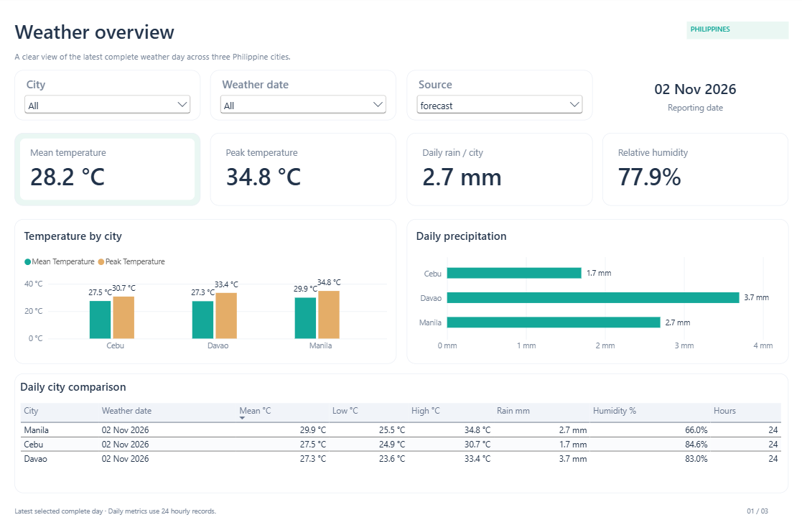
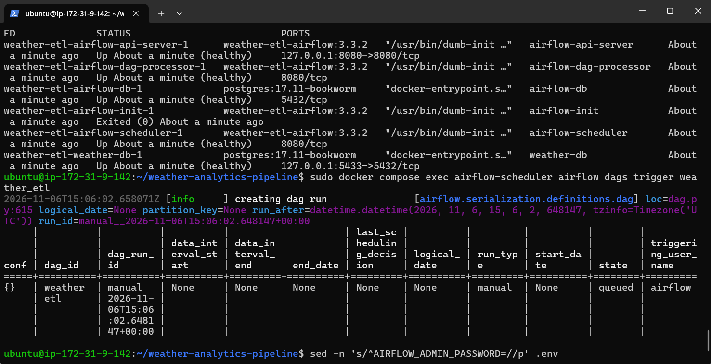
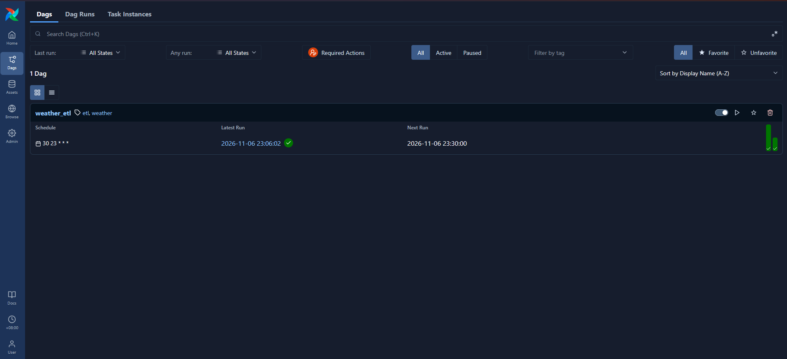

# Philippine Weather Analytics Pipeline

A small data engineering project that collects hourly weather forecasts for **Manila,
Cebu, and Davao**, validates them with Python, stores forecast history in PostgreSQL,
and presents daily comparisons in Power BI. Apache Airflow runs the ETL every day
at **6:00 AM Asia/Manila**.

Built to practice API ingestion, data validation, SQL modeling, idempotent loads,
date-based recovery, orchestration, and visualization.



*Overview report with saved forecast data for 2 November 2026.
[Download the Power BI report](power_bi/weather_analytics.pbix) to explore all three pages.*

## How it works

```text
Open-Meteo → raw JSON + metadata → validated CSV → PostgreSQL → SQL views → Power BI
              extract               transform       load

Airflow runs one extract → transform → load chain per city.
```

- **Extract:** requests one local weather day and saves the original response with
  its city, source URL, requested date, and UTC fetch time.
- **Transform:** combines the API's parallel arrays into rows. Invalid units,
  incomplete days, unequal arrays, missing measurements, and invalid ranges fail
  validation instead of silently changing the data. Humidity must be a whole
  percentage to match the database column.
- **Load:** inserts a snapshot in one transaction. Reloading the same CSV skips
  existing rows; a later fetch preserves a new version.
- **Analyze:** SQL views select the latest value for each weather hour and produce
  daily temperature, humidity, and precipitation summaries.

Weather timestamps use Asia/Manila time. Fetch timestamps use UTC.
The data represents **model forecasts, not weather-station observations**.

## Run locally

Commands below use PowerShell from the repository root.

### 1. Prepare the environment

Requirements: Python 3.10+ (developed with 3.11), Docker Desktop with Linux
containers and Docker Compose, and an internet connection. Power BI Desktop is
optional for viewing the report. Airflow runs in Docker; local Python runs the
ETL modules and offline tests.

```powershell
python -m venv .venv
.\.venv\Scripts\python.exe -m pip install -r requirements.txt
if (-not (Test-Path .env)) { Copy-Item .env.example .env }
```

If `.env` already exists, keep it. Fill in these settings before running Compose:

| Setting | Value to provide |
| --- | --- |
| `WEATHER_DB_PASSWORD` | Local weather database password |
| `AIRFLOW_DB_PASSWORD` | Separate metadata database password; use letters and numbers because it appears in a connection URL |
| `AIRFLOW_ADMIN_PASSWORD` | Airflow UI password for username `admin` |
| `AIRFLOW_FERNET_KEY` | Fernet key generated below |
| `AIRFLOW_JWT_SECRET` | Random secret generated below |

Generate a Fernet key and a JWT secret, then paste each output into `.env`:

```powershell
.\.venv\Scripts\python.exe -c "import base64,os; print(base64.urlsafe_b64encode(os.urandom(32)).decode())"
.\.venv\Scripts\python.exe -c "import secrets; print(secrets.token_hex(32))"
```

Keep these settings stable across restarts. `.env` is ignored by Git; only the
placeholder template is committed. Environment variables take precedence over
`.env`. Compose requires all settings even when starting only the weather database.

### 2. Start the services

```powershell
docker compose build airflow-api-server
docker compose up -d --wait --wait-timeout 120 airflow-api-server airflow-scheduler airflow-dag-processor weather-db
docker compose ps -a
```

First startup can take a few minutes. Allocate at least 4 GB of memory to Docker,
preferably 8 GB. `airflow-init` should finish with `Exited (0)`.

| Service | Purpose |
| --- | --- |
| `weather-db` | Weather data; exposed locally at `localhost:5433` |
| `airflow-db` | Airflow metadata; internal to Docker |
| `airflow-init` | Migrates metadata and synchronizes the admin password |
| `airflow-api-server` | Airflow UI and API at `localhost:8080` |
| `airflow-scheduler` | Schedules and executes tasks with LocalExecutor |
| `airflow-dag-processor` | Parses the DAG |

This setup pins Airflow 3.3.2 with Python 3.12 and PostgreSQL 17.11.
The services share the ETL code and files; LocalExecutor does not need Redis or
separate Celery workers. Database data, Airflow logs, and authentication state use
named Docker volumes. Published ports bind to localhost for local development.

### 3. Collect data

If upgrading an older database, apply the [schema migration](#upgrade-an-older-database)
below before loading any data. Fresh databases need no migration.

Open [Airflow](http://localhost:8080), sign in as `admin` using
`AIRFLOW_ADMIN_PASSWORD`, and trigger the `weather_etl` DAG. Or run:

```powershell
docker compose exec airflow-scheduler airflow dags trigger weather_etl
```

Each city has three tasks, for nine tasks total. File paths pass through XCom;
the data stays in the shared `data/` directory. Tasks use their exact upstream
filename rather than searching for the newest file.

Scheduled runs begin from 31 October 2026 at 6 AM Manila time. Keep the services
running for scheduled collection. `catchup=False` avoids automatic historical
runs, and `max_active_runs=1` prevents overlapping DAG runs. Each failed task has
two retries with a five-minute delay. A failed city blocks its own downstream
tasks; other cities can finish, while the DAG still reports failure.

### 4. Create the analytical views

After the first successful load creates `weather_forecasts`, run this once:

```powershell
Get-Content sql/analytics.sql -Raw | docker compose exec -T weather-db sh -c 'exec psql -U "$POSTGRES_USER" -d "$POSTGRES_DB" --single-transaction -v ON_ERROR_STOP=1'
```

The command can be reapplied. These are ordinary views: later ETL loads appear
when queried, without a separate Airflow refresh task.

## AWS deployment

The existing Docker Compose stack ran on one Ubuntu 24.04 EC2 instance in
Sydney. Airflow and both PostgreSQL services ran on EC2, and the Airflow UI was
accessed through an SSH tunnel. The manual DAG run succeeded on November 6,
2026. We temporarily set the EC2 demo schedule to 23:30 Manila time that day
to test a run with the local PC off. Verification of that run is pending.

### Why EC2 for this demo?

This is a learning project with one daily job. The goal was to run the existing
pipeline independently of the local PC. One EC2 instance let us reuse
`compose.yaml`, keep Airflow and PostgreSQL on the same host, and practice
setting up a Linux server, connecting over SSH, and checking container health.

Amazon ECS would add task definitions and choices about networking and persistent
storage. For a short demo, managing one instance kept the setup small. The
tradeoff is that we manage the host and the pipeline depends on that one machine.
[ECS task definitions](https://docs.aws.amazon.com/AmazonECS/latest/developerguide/task_definitions.html)
and [ECS storage options](https://docs.aws.amazon.com/AmazonECS/latest/developerguide/using_data_volumes.html)
describe the additional configuration.

### Start the stack on EC2

Use an Ubuntu 24.04 x86-64 instance sized for Airflow and both PostgreSQL
containers. Check the account plan, available credits, and estimated cost of
EC2, its EBS disk, and public IPv4 for the demo window. Allow inbound SSH from
your IP and keep the Airflow and PostgreSQL ports bound to localhost.

Connect to EC2 over SSH and prepare the project in the Ubuntu terminal.

```bash
sudo apt-get update && sudo apt-get install -y docker.io docker-compose-v2 git
sudo systemctl enable --now docker
git clone https://github.com/lordyestalani/weather-analytics-pipeline.git
cd weather-analytics-pipeline
sudo install -d -o 50000 -g 0 -m 0770 data
(umask 077; cp -n .env.example .env)
```

The shared `data/` directory gives the Airflow container write access to its
forecast files. Edit `.env` on EC2 and fill in the five secrets from
[Prepare the environment](#1-prepare-the-environment). Use `python3` in Ubuntu
for the key generation commands and generate fresh passwords for this deployment.

```bash
sudo docker compose build airflow-api-server &&
sudo docker compose up -d --wait --wait-timeout 180 \
  airflow-api-server airflow-scheduler airflow-dag-processor weather-db
sudo docker compose ps -a
```

Compose runs in detached mode, so the services stay up after SSH disconnects.
The five long-running services should be healthy and `airflow-init` should
show `Exited (0)`.

### View Airflow through an SSH tunnel

We used SSH local port forwarding to view the Airflow UI on EC2. Run this in
a separate terminal on your PC with your key path and EC2 hostname.

```text
ssh -N -L 8080:127.0.0.1:8080 -i "path-to-key.pem" ubuntu@EC2_PUBLIC_DNS
```

`-N` opens the tunnel without starting a remote shell. `-L` forwards port
`8080` on your PC to `127.0.0.1:8080` on EC2, where Airflow listens. Keep that
terminal open while you use the UI. If the local Weather ETL stack is using
port `8080`, stop it before opening the tunnel.

Open [Airflow](http://localhost:8080) and sign in as `admin` using
`AIRFLOW_ADMIN_PASSWORD` from the EC2 `.env`. On **Dags**, open `weather_etl`
to see its schedule and **Next Run** time. In **Dag Runs**, check **Run Type**,
**State**, and **Start Date** to verify when a scheduled run actually started
and whether it succeeded.

### Trigger and verify the manual DAG run

Trigger `weather_etl` from the repo directory on EC2.

```bash
sudo docker compose exec airflow-scheduler airflow dags trigger weather_etl
```



The terminal output shows the manual run was queued. In **Dag Runs**, look
for a **Manual** run and check its final state.



Airflow recorded **Success** for the November 6, 2026 manual run at 11:06 PM
Manila time. All nine extract, transform, and load tasks succeeded across
Manila, Cebu, and Davao.

### Verify the scheduled run and clean up

For the demo, we set the cron expression to `30 23 * * *` in the EC2 copy of
`dags/weather_etl_dag.py` and checked that Airflow showed **Next Run** at 23:30
Manila time. Leave EC2 and its containers running, keep `weather_etl` unpaused,
and turn off the local PC before that time. After reconnecting, confirm a new
**Scheduled** run succeeded and check its actual start time. Record the deployed
commit, run timestamp, and PostgreSQL row counts by city for the weather date.
Restore `0 6 * * *` on EC2 after the test to resume the usual 06:00 schedule.

After the demo, export the results you want to keep, terminate the instance,
and check for remaining EBS volumes and allocated public IPs. For ongoing
collection, account for recurring EC2 costs and verify that the Compose
services come back after an instance reboot.

**Optional follow-up:** Add a separate Airflow task to copy the raw JSON and
metadata to private S3. Use an EC2 IAM role scoped to the archive prefix and keep
the same object keys on upload retries.

AWS references: [Pricing Calculator](https://calculator.aws/),
[EC2 instance states and billing](https://docs.aws.amazon.com/AWSEC2/latest/UserGuide/ec2-instance-lifecycle.html),
[EC2 IAM roles](https://docs.aws.amazon.com/AWSEC2/latest/UserGuide/iam-roles-for-amazon-ec2.html),
and [EC2 termination](https://docs.aws.amazon.com/AWSEC2/latest/UserGuide/terminating-instances.html).

## Data model

| Object | One row represents |
| --- | --- |
| `weather_forecasts` | One city weather hour in one fetched snapshot |
| `latest_weather_hourly` | Latest fetched value per city, weather hour, timezone, and source type |
| `daily_weather_summary` | Daily metrics per city, local date, timezone, and source type |

The raw table's primary key is:

```text
(city, weather_time_local, timezone, data_type, fetched_at_utc)
```

`ON CONFLICT DO NOTHING` makes loading the same snapshot repeatable. Existing
snapshot rows are immutable; fetching again creates a new version. The views
remove repeated hour versions before calculating daily totals.

Use `is_complete_day` for full-day comparisons: it requires 24 hour-aligned
records. `hours_available` exposes incomplete coverage. `selected_snapshot_count`
shows how many fetches contributed to a daily summary; `data_as_of_utc` is the
latest fetch time, not the weather date or model issue time.

To inspect the database:

```powershell
docker compose exec weather-db sh -c 'exec psql -U "$POSTGRES_USER" -d "$POSTGRES_DB"'
```

```sql
SELECT city, weather_date, average_temperature_c,
       maximum_temperature_c, total_precipitation_mm, hours_available
FROM daily_weather_summary
WHERE data_type = 'forecast'
  AND timezone = 'Asia/Manila'
  AND is_complete_day
ORDER BY weather_date DESC, city;
```

Exit the SQL prompt with `\q`.

## Dates and backfills

Dates use `YYYY-MM-DD` in Asia/Manila and cannot be in the future.

| Requested day | API | Stored `data_type` |
| --- | --- | --- |
| Today | Forecast | `forecast` |
| Earlier day | Historical Forecast | `historical_forecast` |

Historical recovery retrieves archived model output. It does not reproduce the
exact snapshot a past scheduled run would have collected. Keep historical and
current forecasts separate when comparing data. Unsupported or incomplete
responses fail validation.

Recover an inclusive date range for all three cities:

```powershell
docker compose exec airflow-scheduler python -m weather_etl.backfill --start-date 2026-10-31 --end-date 2026-11-01 --cities manila cebu davao
```

The command runs sequentially and stops at the first failure. Each city-day load
has its own transaction, so earlier successes remain committed. Resume with the
remaining dates and cities. Omitting `--cities` defaults to Manila.
This CLI calls the ETL functions directly; it does not create Airflow backfill runs.

For a dated DAG run, set `weather_date` in Airflow's **Trigger Dag** form. The
override applies to all three cities. Without it, scheduled runs use their logical
date in Manila; manual runs without a logical date use their trigger time. This
keeps the requested day stable across delays and retries.

<details>
<summary>Run individual ETL steps locally</summary>

```powershell
.\.venv\Scripts\python.exe -m weather_etl.extract --city cebu --date 2026-11-01
.\.venv\Scripts\python.exe -m weather_etl.transform "data/raw/<snapshot>.json"
.\.venv\Scripts\python.exe -m weather_etl.load "data/processed/<snapshot>.csv"
```

Use the actual filenames printed by each step. Keep the `.metadata.json` beside
its raw JSON. Omitting `--city` selects Manila; omitting `--date` selects today.
City configuration is centralized in `weather_etl/cities.py`.

Local commands use `localhost:5433`; containers use `weather-db:5432`.
The default database and username are both `weather`.

</details>

<details>
<summary id="upgrade-an-older-database">Upgrade a database created before historical-forecast support</summary>

Fresh databases receive the current schema automatically on first load.
For an older database, run the migration before any updated loader run:

```powershell
Get-Content sql/migrations/001_historical_forecasts.sql -Raw | docker compose exec -T weather-db sh -c 'exec psql -U "$POSTGRES_USER" -d "$POSTGRES_DB" --single-transaction -v ON_ERROR_STOP=1'
```

This preserves rows, allows `historical_forecast`, and includes `data_type` in
the primary key. Reapply `sql/analytics.sql` if updating existing views.

</details>

## Power BI report

Open [weather_analytics.pbix](power_bi/weather_analytics.pbix) in Power BI Desktop.
The standalone file includes saved data, visuals, queries, and DAX measures.
No supporting project files are needed. Only the PBIX is tracked in `power_bi/`.
Use the bottom tabs to navigate:

- **Overview:** latest selected complete weather day, city comparisons, mean and
  peak temperatures, daily rain per city, and relative humidity.
- **Hourly patterns:** temperature, rainfall, and humidity through the latest
  selected weather day.
- **Snapshot history:** stored rows, distinct weather hours, city snapshot
  batches, and additional versions retained by the pipeline.

City, date, and source selectors apply within each page. The weather pages default
to `forecast`; clearing the source selector also defaults their measures to
`forecast`. Daily rain is averaged per city, not summed across different places.
Each page uses its own database table or view to avoid multiplying metrics by
joining raw snapshot history to analytical summaries.

The model uses **Import** mode. Opening it displays cached data; to update it:

1. Start PostgreSQL, run the pipeline, and create the SQL views as described above.
2. Select **Home > Refresh** in Power BI Desktop.
3. When prompted, enter your local credentials for PostgreSQL at `localhost:5433`,
   database `weather`. Change the data source settings if your host or port differs.
4. Save the PBIX to retain the refreshed data.

Report refresh reads PostgreSQL; it does not run Airflow. The README image is a
static snapshot and must be replaced separately when you want a newer preview.

## Tests

Run offline checks with local Python; database and DAG checks are skipped:

```powershell
.\.venv\Scripts\python.exe -m unittest discover -v
```

With the Docker services running, run the complete suite in the Airflow image:

```powershell
docker compose run --rm --no-deps -e WEATHER_DB_TESTS=1 -v "${PWD}/tests:/opt/airflow/project/tests:ro" airflow-scheduler python -m unittest discover -v
```

Tests cover validation, file handoff, city/date separation, duplicate prevention,
transaction rollback, historical migration, latest-version analytics, complete-day
flags, and DAG dependencies and schedule. Database tests use temporary schemas;
they do not modify the project's weather table. HTTP responses are mocked in tests.

## Repository layout

```text
weather_etl/             Python ETL, city configuration, and date recovery
dags/                  Daily Airflow DAG
docker/airflow/         Airflow image and initialization
sql/                   Schema, analytical views, and migration
tests/                 Offline, PostgreSQL, and DAG checks
power_bi/              Standalone weather_analytics.pbix
docs/images/           Dashboard screenshot
compose.yaml           Local services and persistent volumes
requirements.txt       Python dependencies
.env.example           Configuration template
```

Raw JSON and CSV files under `data/`, local environments, credentials, and Power BI
working files are ignored by Git. The Docker build context includes only the
files needed to build the Airflow image.

## Operations and limits

```powershell
docker compose logs --tail 50 airflow-scheduler airflow-dag-processor
docker compose stop
docker compose start
```

- To change the Airflow UI password, edit `.env` and run
  `docker compose run --rm airflow-init`.
- `docker compose down` removes containers but preserves named volumes. Adding
  `--volumes` deletes stored database and Airflow state.
- PostgreSQL initialization credentials apply only to an empty volume. Editing
  `.env` does not change a password already stored in the database.
- This is a local learning setup with an administrative database account and
  Airflow's SimpleAuthManager. Deployment would need dedicated roles and managed
  secrets.
- File writes for raw snapshots and transformed CSVs are not atomic. Rerun the
  affected step after an interrupted write. Airflow retries provide recovery, but
  there is no raw-file retention policy or alerting integration yet.
- Requests uses certificate verification and a 30-second network timeout.
  No custom truststore or disabled TLS verification is required.

## Sources

Weather data: [Open-Meteo](https://open-meteo.com/),
[Forecast API](https://open-meteo.com/en/docs), and
[Historical Forecast API](https://open-meteo.com/en/docs/historical-forecast-api).
Check the [terms and attribution requirements](https://open-meteo.com/en/terms)
before using the service beyond this learning project.

Infrastructure: [Apache Airflow Docker guide](https://airflow.apache.org/docs/apache-airflow/3.3.2/howto/docker-compose/index.html)
and [official PostgreSQL image](https://hub.docker.com/_/postgres).
